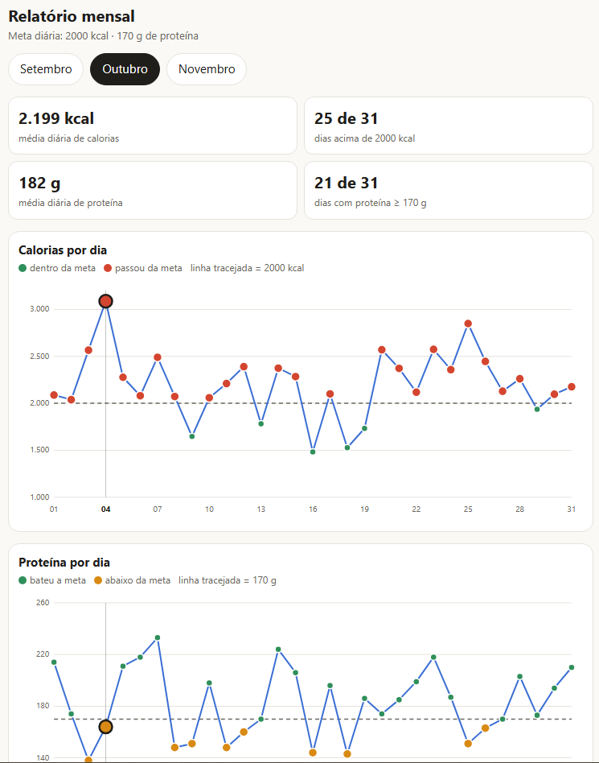

# Contador de calorias (skill para o Claude)

Skill que transforma o Claude num diário alimentar: você manda o que comeu (texto, áudio, foto do prato ou do rótulo) e ele calcula calorias, proteína, carboidrato e gordura, guarda no Notion, Google Planilhas ou arquivo, e responde com o total do dia e a porcentagem de cada meta. Quando você pede "relatório mensal", ele gera uma página com gráficos de calorias e proteína por dia, onde você toca em um ponto para ver as refeições daquele dia.



*Exemplo do relatório mensal: cada ponto dos gráficos é um dia; ao tocar nele, aparece a tabela de refeições.*

> As calorias são estimativas. Esta skill não substitui nutricionista ou médico.

## Veja funcionando

Vídeo mostrando o uso real da skill, com as minhas refeições e o relatório mensal: **[assistir no YouTube](https://youtu.be/IdxHnz_oVwU)**

## Como instalar no Claude (app/site)

1. Baixe o arquivo `contador-de-calorias.zip` (em *Releases* ou na raiz do repositório).
2. No Claude, vá em **Customize > Skills**, clique em **+** e escolha **Upload a skill**.
3. Envie o zip e ative a skill.
4. Na primeira conversa, diga algo como "vou começar a contar calorias". A skill pergunta onde guardar os dados e quais são as suas metas.

Para guardar no Notion ou no Google Planilhas, ative o conector correspondente no Claude. Sem conector, a skill usa um arquivo CSV/.xlsx.

## Como usar

### 1. Primeira vez: configuração

Na primeira conversa, a skill pergunta, uma coisa de cada vez:

1. **Onde guardar os registros:** Notion (ative o conector do Notion), Google Planilhas (conector do Google Drive), arquivo CSV/xlsx ou só a conversa. O Notion é a opção mais prática; a conversa é a mais frágil, porque você pode perder o histórico.
2. **Suas metas diárias:** calorias, proteína, carboidrato e gordura. Se você não souber, ela sugere um ponto de partida para você conversar com um profissional.

Ela cria a tabela de registro e uma página de **alimentos frequentes**. Nas próximas conversas, não pergunta tudo de novo.

### 2. Registrar uma refeição

Mande do jeito mais rápido para você:

- **Texto:** `2 whey e 100 g de carne assada`
- **Foto do prato** (a estimativa é aproximada e fica marcada como "estimado")
- **Foto do rótulo ou da tabela nutricional** (é a fonte mais confiável)

A cada lançamento, ela responde com os valores da refeição e o **total parcial do dia**, com cada macro em % da meta. Assim você ajusta as próximas refeições ao longo do dia.

Dica: em carnes e cereais, diga se o peso é **cru ou cozido**. Os valores mudam muito.

### 3. Alimentos frequentes

Quando você repete um alimento ou uma receita sua (vitamina, pasta de atum, sanduíche), a skill oferece salvá-lo. Depois, basta escrever `pasta de atum`: ela usa os valores salvos e a mesma porção, sem pedir tudo de novo. Para ver a lista, peça `meus alimentos frequentes`.

### 4. Relatório mensal

Peça `relatório mensal`. Você recebe uma página com:

- abas por mês e médias de calorias e proteína;
- gráfico de calorias (pontos vermelhos nos dias acima da meta);
- gráfico de proteína (verde se bateu a meta, laranja se ficou abaixo);
- **toque em um ponto** para ver as refeições daquele dia, com a que mais pesou destacada.

### Dicas

- Quanto mais refeições cadastradas, mais precisa fica a contagem. Estimativas por foto servem para o dia em que você come fora.
- Comeu fora do plano? Veja o total parcial e ajuste as refeições seguintes. Sem pular refeição, e do jeito que o seu profissional combinou com você.
- Para lançar em um dia passado, diga a data: `no dia 30, adicione...`.

## Outros usos

- **Claude Code:** copie a pasta `contador-de-calorias/` para `~/.claude/skills/`.
- **Outras IAs:** cole o conteúdo de `contador-de-calorias/SKILL.md` como instruções. Perde a ativação automática.

## Estrutura

```
contador-de-calorias/
  SKILL.md
imagens/
  relatorio-mensal.png
```
